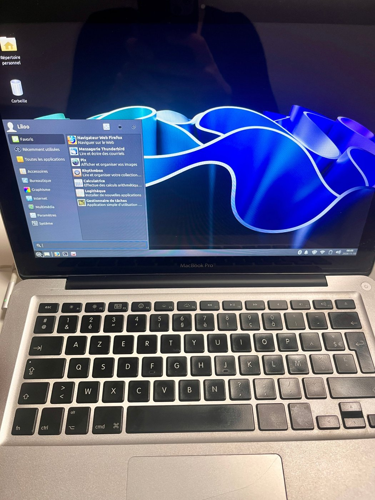
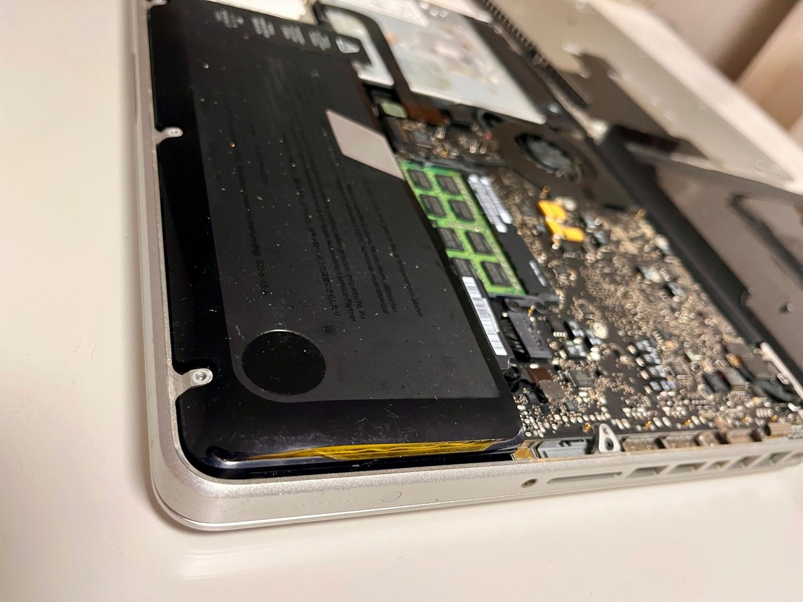
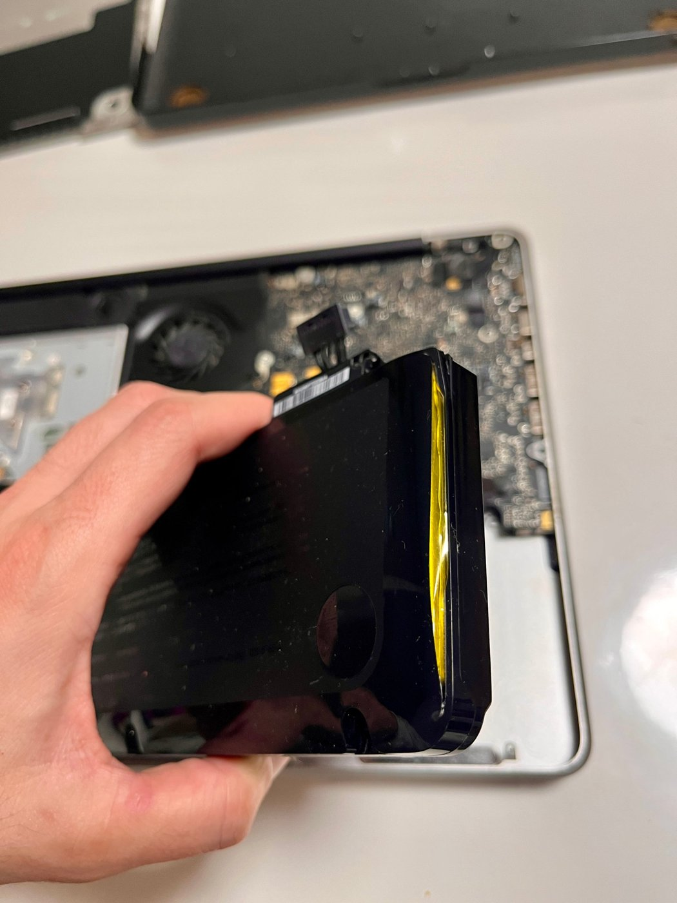
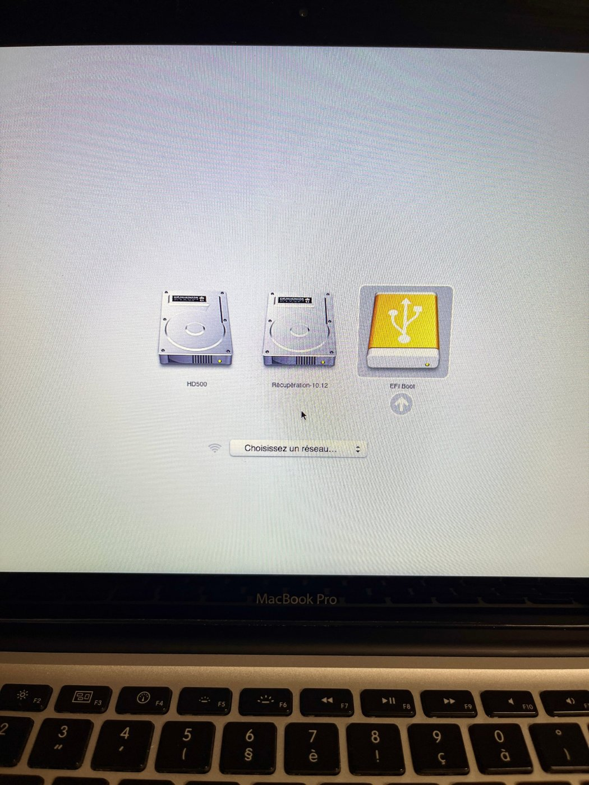

[README.md](https://github.com/user-attachments/files/34827066/README.md)
# 🐧 Ressusciter un MacBook Pro 13" (2010) avec Linux Mint Xfce

> Projet pratique réalisé dans le cadre de ma formation **Administratrice Systèmes & Réseaux (ASR)** chez DesCodeuses.
> Un MacBook Pro oublié dans un tiroir depuis plus de 10 ans → une machine Linux à jour, sécurisée et utilisable.

<p align="center">
  
</p>

---

## 📋 Sommaire

1. [Contexte](#-contexte)
2. [Objectifs](#-objectifs)
3. [Pourquoi quitter macOS ?](#-pourquoi-quitter-macos-)
4. [Matériel](#-matériel)
5. [Étapes de la reconfiguration](#-étapes-de-la-reconfiguration)
6. [La leçon cyber du projet](#-la-leçon-cyber-du-projet)
7. [Limites et prochaines étapes](#-limites-et-prochaines-étapes)
8. [Compétences mobilisées](#-compétences-mobilisées)
9. [Remerciements](#-remerciements)

---

## 📖 Contexte

État de départ de la machine :

| Élément | État |
|---|---|
| Machine | MacBook Pro 13" mi-2010 |
| Système | macOS, bloqué sur High Sierra (10.13), dernière version supportée |
| Batterie | Gonflée, hors service |
| Accès | Mot de passe de session oublié |

## 🎯 Objectifs

- **Donner une seconde vie** à une machine fonctionnelle plutôt que la jeter.
- **Mettre en pratique** ce que j'apprends en formation : boot, partitionnement, installation d'un OS, pilotes, mises à jour, pare-feu.

## ❓ Pourquoi quitter macOS ?

- Ce modèle ne peut pas dépasser **macOS High Sierra**.
- High Sierra ne reçoit plus de **mises à jour de sécurité depuis fin 2020**.
- Les navigateurs ne sont plus mis à jour non plus → naviguer sur Internet devient risqué (failles connues et jamais corrigées).

**Linux Mint**, au contraire, est gratuit, open source et maintenu pendant plusieurs années pour chaque version.

> 🖼️ **Image :** un OS sans mises à jour, c'est une maison dont on ne change plus les serrures alors que tout le monde a le double des clés.

## 🔩 Matériel

- MacBook Pro 13" mi-2010
- Clé USB (8 Go minimum)
- Disque dur externe (pour la sauvegarde)
- Tournevis adaptés (cruciforme 00 + tri-wing Y1 pour la batterie)
- Image ISO **Linux Mint Xfce** <!-- À COMPLÉTER : version exacte, ex. 22.x -->

---

## 🛠️ Étapes de la reconfiguration

### Étape 1 : Retirer la batterie gonflée 🔋

<p align="center">
  
  
</p>

Une batterie lithium gonflée est **dangereuse** (risque d'incendie). Je l'ai retirée avant toute autre manipulation.

**Précautions :**
- Débrancher le chargeur avant d'ouvrir.
- Ne jamais percer, plier ou écraser la batterie.
- La stocker sur une surface non inflammable en attendant le dépôt.
- La déposer dans un **point de collecte** ♻️ (magasin, déchèterie), jamais à la poubelle.

✅ Le Mac fonctionne très bien **sur secteur**, en attendant une batterie neuve.

### Étape 2 : Créer une clé USB bootable 💾

Une clé « bootable » contient un système complet capable de démarrer l'ordinateur sans passer par le disque interne.

1. Télécharger l'ISO **Linux Mint Xfce** sur [linuxmint.com](https://linuxmint.com/download.php).
2. **Vérifier l'intégrité de l'ISO** (bonne pratique sécurité) :
   ```bash
   sha256sum linuxmint-*.iso
   # Comparer le résultat avec le fichier sha256sum.txt publié par Linux Mint
   ```
3. Écrire l'ISO sur la clé avec un outil dédié <!-- À COMPLÉTER : Balena Etcher, Rufus, Ventoy, dd... -->.

**Pourquoi Xfce plutôt que Cinnamon ?**
L'édition Cinnamon était trop lourde pour ce matériel de 2010. Xfce est plus légère : l'affichage est moins joli, mais le système reste rapide.

### Étape 3 : Démarrer en mode « live » et sauvegarder les données 🔄

<p align="center">
  
</p>

1. Brancher la clé, allumer le Mac en maintenant la touche **⌥ Option (alt)**.
2. Le gestionnaire de démarrage s'affiche : choisir **EFI Boot** (la clé USB).
3. Lancer Linux Mint en **mode live** : le système tourne depuis la clé, sans rien modifier sur le disque. C'est un « essai avant installation ».
4. Depuis le gestionnaire de fichiers, ouvrir le disque interne du Mac et **copier les fichiers personnels sur le disque externe**.

> ⚠️ C'est ici que le mot de passe oublié n'a posé **aucun problème**. Voir [La leçon cyber du projet](#-la-leçon-cyber-du-projet).

### Étape 4 : Installer Linux Mint 💻

1. Depuis le mode live, lancer **« Installer Linux Mint »**.
2. Choisir la langue et le clavier (**Français – Macintosh**).
3. Type d'installation : **effacer le disque et installer Linux Mint** (l'ancien macOS est supprimé, les données ayant été sauvegardées à l'étape 3).
4. Créer le compte utilisateur avec un **mot de passe robuste**.
5. Redémarrer et retirer la clé.

### Étape 5 : Réglages après installation ⚙️

#### 📶 Pilote Wi-Fi (l'étape la plus coriace 😅)

La puce Wi-Fi des MacBook de cette époque est une puce **Broadcom**, qui demande souvent un pilote propriétaire.

```bash
# Identifier la carte réseau
lspci -nn | grep -i network
```

Puis, dans **Menu → Administration → Gestionnaire de pilotes**, installer le pilote Broadcom proposé (`bcmwl-kernel-source`).
<!-- À VÉRIFIER : coller ici la sortie de lspci et le pilote réellement installé -->

#### 🔄 Mises à jour de sécurité

Via le **Gestionnaire de mises à jour**, ou en ligne de commande :

```bash
sudo apt update && sudo apt upgrade -y
```

#### 🧱 Activation du pare-feu

Linux Mint inclut le pare-feu **UFW**, désactivé par défaut.

```bash
sudo ufw enable
sudo ufw status verbose
# Résultat attendu : Status: active
# Default: deny (incoming), allow (outgoing)
```

> 🖼️ **Image :** le pare-feu, c'est le vigile à l'entrée. Par défaut, il refuse ceux qui veulent entrer et laisse sortir ceux qui sont déjà à l'intérieur.

---

## 🔒 La leçon cyber du projet

**Je n'avais pas le mot de passe… et j'ai quand même pu lire tout le disque.**

Le mot de passe de session protège l'accès **au système**, pas **aux données**. Si le disque n'est pas chiffré, il suffit de démarrer sur une clé USB (ou de brancher le disque sur une autre machine) pour tout lire.

> 🖼️ **Image :** un mot de passe de session sans chiffrement, c'est une porte blindée sur une maison sans murs. On fait le tour.

**À retenir :**

| Système | Outil de chiffrement du disque |
|---|---|
| macOS | FileVault |
| Windows | BitLocker |
| Linux | LUKS |

👉 Vérifiez que le chiffrement est activé sur vos machines, surtout les portables (perte, vol).

---

## 🚧 Limites et prochaines étapes

- [ ] Remplacer la batterie
- [ ] Chiffrer l'installation Linux (LUKS) <!-- À ADAPTER : supprimer cette ligne si le chiffrement a été coché à l'installation -->
- [ ] Mettre en place une sauvegarde régulière (ex. Timeshift pour le système)
- [ ] Remplacer le disque dur par un SSD pour gagner en rapidité

---

## 🧠 Compétences mobilisées

- Diagnostic matériel et sécurité électrique (batterie lithium)
- Création d'un support d'installation bootable et vérification d'intégrité (SHA-256)
- Démarrage EFI et utilisation d'un système live
- Sauvegarde de données avant intervention
- Installation et partitionnement d'un système Linux
- Gestion des pilotes propriétaires
- Durcissement de base : mises à jour, pare-feu UFW
- Sensibilisation : chiffrement des données au repos

---

## 🙏 Remerciements

Merci à **Djoan**, formateur ASR chez **DesCodeuses**, pour les bases qui m'ont permis de me lancer.

---

*Projet réalisé en novembre 2026, dans le cadre de ma reconversion en administration systèmes et réseaux.*
